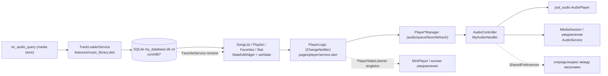

# Архитектура приложения Dot Music

> Описание соответствует текущему состоянию рабочего дерева (все изменения P0–P3 применены, но **не закоммичены**). Незакоммиченная правка пользователя в `lib/core/db/db_helper.dart` — `ORDER BY t.created_at DESC` — сохранена.
>
> План работ и статус каждого пункта: [`TODO.md`](TODO.md).

---

## 1. Общая характеристика

Офлайн-плеер на Flutter: локальные аудиофайлы сканируются через `on_audio_query`, метаданные и пользовательские данные хранятся в SQLite (`sqflite`), воспроизведение идёт через `just_audio` + `audio_service` с медиа-уведомлением Android. Интерфейс — Material 3, две локали (RU — шаблон, EN).

| Подсистема | Технология | Где используется |
|---|---|---|
| UI | Flutter Material 3, `setState` | `lib/features/pages/**` |
| Навигация | `go_router` 16.x, `PlayerRouteArgs`, `errorBuilder` | `lib/core/router.dart` |
| Локальная БД | `sqflite` v4, `path_provider`, `sqflite_common_ffi` в тестах | `lib/core/db/**` |
| Сканирование медиатеки | `on_audio_query`, кэш метаданных | `lib/features/music_library.dart`, `lib/core/service.dart` |
| Звук / фон | `just_audio`, `audio_service`, `shared_preferences` | `lib/features/player/**` |
| Разрешения | `permission_handler` | `lib/features/player/audio.dart`, `on_audio_query.permissionsRequest()` |
| Локализация | `flutter_localizations`, `intl`, ARB + `l10n.yaml` | `lib/l10n/**`, `context.l10n.*` |
| Логирование | `logger` | `lib/core/config.dart` |
| Состояние | `PlayerLogic extends ChangeNotifier` + синглтоны-шины | `lib/features/pages/player/**` |
| Build-time утилиты | `flutter_native_splash`, `flutter_launcher_icons` (dev deps) | `pubspec.yaml` |

Официально поддерживаются Android/iOS; каталоги `linux/`, `macos/`, `windows/` присутствуют, но сцена работы с `UriType.EXTERNAL` ориентирован на Android.

---

## 2. Точка входа и инициализация

`lib/main.dart`:

1. `WidgetsFlutterBinding.ensureInitialized()`.
2. `await DatabaseHelper().db` — открытие/создание БД версии 4.
3. `await initAudioService()` — на Android сначала `Permission.notification.request()`, затем `AudioService.init<MyAudioHandler>()`; результат сохраняется в глобальный `late AudioController audioHandler` (`lib/features/player/audio.dart`).
4. `runApp(const DotMusic())`. `MaterialApp.router` получает `localizationsDelegates`, `supportedLocales`, тему с палитрой `design/colors.dart`, `routerConfig: router` и `onGenerateTitle` (заголовок берётся из `context.l10n` уже внутри `Localizations`). В `builder` приложение передаёт локализацию в `TrackLoadingState.l10n` — прогресс сканирования показывается вне виджетов. Обращение к `context.l10n` до `MaterialApp` недопустимо: оно привело бы к `Null check operator used on a null value` и белому экрану.
5. `unawaited(initTracksInBackground())` — автосканирование после старта UI; кнопка на главной остаётся как «пересканировать».

Bundle id: `com.dotmusic.app` (prod, iOS), `com.dotmusic.app.dev` (dev Android), канал уведомлений `com.dotmusic.app.channel.audio`.

---

## 3. Структура проекта

```text
lib/
├── main.dart                      # точка входа, локализация, тема, routerConfig
├── l10n/
│   ├── app_ru.arb                 # шаблон (RU)
│   ├── app_en.arb                 # EN
│   ├── l10n.dart                  # export AppLocalizations + BuildContext.l10n
│   └── app_localizations*.dart    # генерируются flutter gen-l10n
├── core/
│   ├── config.dart                # общий logger
│   ├── router.dart                # GoRouter, PlayerRouteArgs, errorBuilder
│   ├── service.dart               # кэш метаданных на основе одного querySongs
│   └── db/
│       ├── db.dart                # DatabaseHelper (v4), migrateDatabase, reset/delete
│       ├── schema.dart            # DDL, UNIQUE/NOT NULL ограничения
│       ├── db_helper.dart         # DbHelper: выборки tracks/плейлистов
│       ├── crud.dart              # PlaylistService, PlaylistView, SongService
│       ├── fav_service.dart       # FavoriteService + ValueNotifier revision
│       ├── block_service.dart     # чёрный список
│       ├── stat_crud.dart         # StatRepository (атомарный UPSERT)
│       └── stat_service.dart      # выборки статистики
├── design/
│   ├── colors.dart                # палитра, подключена к ThemeData
│   └── art.dart                   # генератор уникальной градиентной обложки
├── features/
│   ├── music_library.dart         # TrackLoaderService: разрешения + scan + вставка
│   ├── player/
│   │   ├── audio_controller.dart  # контракт аудиодвижка (DI/тесты)
│   │   ├── audio.dart             # глобальный AudioController, AudioService.init
│   │   └── audio_handler.dart     # MyAudioHandler: очередь, media session, преfs
│   ├── queue/queue.dart           # QueueService: ротация/шафл, порядок по путям
│   ├── track_service/
│   │   ├── load_tracks.dart       # TrackLoadingState + initTracksInBackground
│   │   ├── device_metadata.dart   # date_added с устройства (не из БД)
│   │   ├── delete_service.dart    # обёртка над BlockService (мягкое удаление)
│   │   └── edit_info.dart         # диалог переименования (только возвращает имя)
│   └── pages/
│       ├── home/                  # HomePage, анимированный заголовок, форма плейлиста
│       ├── song_list/             # список треков, SongCard, TrackTile, sort.dart, диалог плейлиста
│       ├── playlist/              # список плейлистов и треки плейлиста
│       ├── favorite_songs/        # избранное
│       ├── player/                # PlayerPage, MiniPlayer, MiniPlayerScaffold,
│       │                          # PlayerLogic + 5 менеджеров, UI/UI-виджеты
│       └── stat/                  # top/month/year отчёты, StatList
android/                            # flavors dev/prod, манифест, подпись из key.properties,
                                    # MainActivity в пакете com.dotmusic.app (совпадает с namespace)
ios/                                # Runner, Info.plist, Podfile
.github/workflows/ci.yml            # JDK 17, pub get → analyze → format → test → build apk
test/                               # 8 файлов тестов + fake аудиоконтроллер
l10n.yaml                           # генерация AppLocalizations из app_ru.arb
analysis_options.yaml               # flutter_lints + 4 ужесточенных правила
```

Удалены неиспользуемые `player_control.dart`, `play_music.dart`, `player_manager.dart`, пустой `lib/core/db/db_test.dart` и сгенерированный Android-отчёт; `montly_stat.dart` переименован в `monthly_stat.dart`.

---

## 4. Слои и потоки данных



Остались известные зависимости «снизу вверх»: `crud.dart` импортирует `core/service.dart` (platform-слой), `audio_handler.dart` знает о `PlayerStateListener` из UI-слоя, `PlayerLogic` работает с БД через менеджер. Вместо полноценного DI — синглтоны (`DatabaseHelper`, `FavoriteService`, `PlayerStateListener`, `_trackLoader`, `TrackLoadingState`, `router`). Исключение: аудиоконтроллер вынесен за интерфейс `AudioController` и подменяется в тестах; `PlayerLogic` принимает его в конструкторе.

---

## 5. Модель данных

База — `my_database.db` в `getApplicationDocumentsDirectory()`. `onCreate` выполняет `Schema.createTables`. Версия схемы — **4**.

| Таблица | Ключевые поля | Ограничения |
|---|---|---|
| `tracks` | `id`, `title`, `artist`, `path`, `playback_count`, `created_at` | `path UNIQUE`, `playback_count NOT NULL DEFAULT 0` |
| `playlists` | `id`, `name`, `created_at` | `name UNIQUE` |
| `playlist_tracks` | `playlist_id`, `track_id`, `added_at` | PK `(playlist_id, track_id)`, FK `ON DELETE CASCADE` |
| `listening_stat` | `track_id`, `month`, `year`, `playback_count` | `UNIQUE(track_id, month, year)`, FK на `tracks` |
| `favorite_songs` | `track_id` | `UNIQUE(track_id)`, FK на `tracks` |
| `black_list` | `track_id`, `path` | `UNIQUE(track_id)`, FK на `tracks` |

Миграции вынесены в `migrateDatabase(db, oldVersion, newVersion)`: v1→v2 создаёт таблицы, v2→v3 добавляет `year` (только если колонки нет), v3→v4 чистит дубли и добавляет уникальные индексы. Функция идемпотентна и покрыта тестами. `resetDatabase()` дропает и пересоздаёт схему, `deleteDatabaseFile()` предварительно закрывает БД, `DbHelper.getTrackInfoById()` возвращает `null` для битых записей.

Выборки (`DbHelper.getAllTracks()` с `ORDER BY t.created_at DESC` и без чёрного списка, `PlaylistView.getSongsFromPlaylist()`, `getTrackInfoById()`) возвращают `Map<String, dynamic>`. Sentinel-значения для «исходного списка»: `0` — все треки, `-1` — избранное, `>0` — id плейлиста.

---

## 6. Управление состоянием

- **`PlayerLogic extends ChangeNotifier`** (`pages/player/service.dart`) — единственный источник правды о плеере. Состояние лежит в `PlayerState` (`player_state.dart`): songs/originalSongs, currentSongIndex, trackId, playbackCount, позиция/длительность, isPlaying, isFavorite, repeatMode, error. `notify()` — единственная обёртка над `notifyListeners()` и не вызывает его после `dispose()`.
- **Менеджеры** (`player_*_manager.dart`): аудио (потоки позиции/длительности, переключение треков, completion, stop), очередь (initial rotate, repeat/shuffle, порядок по путям, drag-and-drop, дублирование, «слушать следующим», удаление из очереди), избранное (revision + статус текущего трека), треки (загрузка списка, инкремент статистики, мягкое удаление из библиотеки).
- **`PlayerStateListener`** (`player_holder.dart`) — синглтон-владелец активного `PlayerLogic`: мини-плеер и кнопки уведомления читают состояние через него; при регистрации нового плеера старый dispose'ится. Закрытие `PlayerPage` снимает только локальный listener — плеер продолжает играть в мини-плеере и фоне.
- **`FavoriteService.revision`** (`ValueNotifier<int>`) — шина изменений избранного между экранами и плеером.
- **`TrackLoadingState`** — статический прогресс сканирования; локализация передаётся в него один раз из `DotMusic.build()`.
- `setState` в экранах используется для локального UI и защищён `mounted`; `BuildContext` после await — через `context.mounted`.

Жизненный цикл плеера: `PlayerPage.initState()` либо переиспользует `PlayerLogic` из `PlayerStateListener` (`fromMiniPlayer: true`), либо создаёт новый и вызывает `await _logic.init()` с обработкой ошибки. `init()`: загрузка списка → сортировка по `queuePaths` → выбор индекса (включая `initialPath`) → ротация очереди → `syncQueue()` (media session) → статус избранного → подписки на потоки → `playFromFile()` → инкремент счётчика конкретного трека. Повтор: `off → one → random → off`; `random` перемешивает очередь и выбирает случайный трек. Нижняя панель очереди подписана на `PlayerLogic` через `ListenableBuilder`, поэтому правки сразу видны в списке.

Правки очереди (`moveInQueue`, `duplicateInQueue`, `playNextInQueue`, `removeFromQueue`) не трогают файлы и записи БД: они меняют только `PlayerState.songs`, корректируют `currentSongIndex`, обновляют `originalSongs` (новая основа при выключении shuffle) и вызывают `syncQueue()`. `MyAudioHandler.setQueue()` переписывает медиа-очередь и `SharedPreferences`; дубли получают уникальные `MediaItem.id` вида `path#index`. Удаление текущего трека запускает следующий, а опустевшая очередь останавливает воспроизведение и показывает `trackListEmpty`.

`AudioController` (`lib/features/player/audio_controller.dart`) фиксируется в `PlayerLogic` при создании: dispose снимает колбэки именно с того контроллера, на котором они были поставлены, даже если глобальный `audioHandler` к тому моменту заменён.

---

## 7. Навигация

`GoRouter` (`lib/core/router.dart`) с маршрутами `/`, `/list`, `/playlists`, `/listpl`, `/player`, `/fav`, `/statistic`, `/statistic/top`, `/statistic/month`, `/statistic/year`.

- `PlayerRouteArgs.parse()` безопасно читает `extra`, query и path-параметры: неверные типы получают fallback, `returnRoute` позволяет вернуться точно на предыдущий экран. Чистая функция тестируется без виджетов.
- `errorBuilder` показывает локализованную заглушку с кнопкой «На главную».
- Навигация: `context.push` вперёд, `context.pop()`/`context.go(returnRoute)` назад. Прямых вызовов глобального `router` из экранов нет — циклический импорт устранён.

---

## 8. Сканирование и фоновая работа

1. `initTracksInBackground()` (`track_service/load_tracks.dart`) защищён `isLoading`-guard и `_scanGeneration`: старый проход не перезаписывает прогресс нового; в начале сбрасываются error/счётчики. Рассылка слушателям идёт по копии списка.
2. `TrackLoaderService.initializePlugin()` → `loadSongs()` (один вызов `permissionsRequest()` + `querySongs`), метаданные кэшируются в `core/service.dart`.
3. `addMissingSongsToDbWithProgress()` добавляет только недостающие треки, передаёт `metadata` в `SongService.addSongToDb()`; ошибка одного трека не прерывает сканирование.
4. Сортировка списка (`pages/song_list/sort.dart`): популярность — по `playback_count` из БД, алфавит — по `title` без учёта регистра, время добавления — по `date_added` из MediaStore (`DeviceTrackMetadata`), кэшированному на сессию; если его нет, используется `mtime` файла. `DeviceTrackMetadata.invalidate()` вызывается перед каждым сканированием. Удаление трека из библиотеки — мягкое: только `black_list`/избранное/плейлист, файл на устройстве не трогается. При переходе в плеер экран передаёт `queuePaths` (порядок видимых треков) через `PlayerRouteArgs`; `PlayerLogic.init()` применяет его через `QueueService.reorderByPaths()` до `makeQueue()`, поэтому next/prev следуют сортировке, а не `created_at`.
5. `MyAudioHandler` хранит очередь и индекс, пишет их в `SharedPreferences` и восстанавливает при старте; `MediaItem.queue`/`PlaybackState.queueIndex` заполнены, `skipToNext/Previous` в уведомлении работают без открытого `PlayerPage`. `onTaskRemoved()` отсутствует — ongoing-уведомление не останавливает музыку. Параметры `artworkPath`/`artworkUri` и методы `updateMetadata()`/`customAction()` определены в контракте, но пока не вызываются плеером.

Платформы:

- **Android**: `MainActivity extends FlutterFragmentActivity`, flavor'ы `dev`/`prod`, разрешения на storage/audio, `FOREGROUND_SERVICE`, `FOREGROUND_SERVICE_MEDIA_PLAYBACK`, `POST_NOTIFICATIONS`, `WAKE_LOCK`, сервис `AudioService` и `MediaButtonReceiver`; release подписывается из `android/key.properties` с fallback на debug для локальной сборки.
- **iOS**: `Podfile` восстановлен, `Info.plist` содержит `UIBackgroundModes = audio` и `NSAppleMusicUsageDescription`, bundle id `com.dotmusic.app`.
- **Десктоп**: каталоги есть, поддержка не реализована.

---

## 9. Тесты и качество кода

- `flutter analyze --no-pub`: `No issues found!`. В `analysis_options.yaml` включены `unawaited_futures`, `discarded_futures`, `avoid_dynamic_calls`, `use_build_context_synchronously`. `strict-casts` не используется: текущий SDK отклоняет опцию (`unsupported_option_with_legal_values`).
- `flutter test --no-pub`: **42 теста** — очередь, миграции/статистика БД, разбор аргументов роутера, рассылка `TrackLoadingState`, `PlayerLogic` (очередь/repeat/media session/dispose/внешний индекс), владение плеером в `PlayerStateListener`, `TrackLoaderService`, сортировка, порядок очереди по сортировке, редактирование очереди и UI панели, мягкое удаление, smoke-виджет. Unit-тесты плеера используют `FakeAudioController` вместо нативных плагинов.
- `dart format --output=none --set-exit-if-changed lib test`: `0 changed`; та же проверка есть в `.github/workflows/ci.yml`.
- `flutter gen-l10n` генерирует `AppLocalizations` из ARB; RU — шаблон, EN — перевод.
- Обе Android-сборки проходят с **JDK 17**: `flutter build apk --flavor dev` и `flutter build apk --release --flavor prod` дают `app-dev-release.apk` / `app-prod-release.apk` (~43 МБ). С системной Java 27 Gradle 9 падает на `jlink` ещё до Dart-компиляции. Лимиты JVM заданы в `android/gradle.properties` (`-Xmx2G` для Gradle, `-Xmx1536m` для Kotlin), JDK 17 подключён в CI. iOS-сборка не проверялась (нет macOS/Xcode).

---

## 10. Как запускать и проверять

```bash
export JAVA_HOME=/usr/lib/jvm/java-17-openjdk   # Android-сборка требует JDK 17
flutter pub get
flutter gen-l10n                        # ARB -> lib/l10n/app_localizations*.dart
flutter analyze --no-pub                # No issues found!
dart format --output=none --set-exit-if-changed lib test
flutter test --no-pub                   # 42 теста
flutter run --flavor dev               # Android
flutter build apk --flavor dev         # app-dev-release.apk
```

iOS: `cd ios && pod install`, затем сборка в Xcode (требуется macOS). Ключ подписи и `android/key.properties` находятся в `.gitignore`. Все изменения пока остаются в рабочем дереве: коммит и пуш выполняются только по отдельной просьбе.
