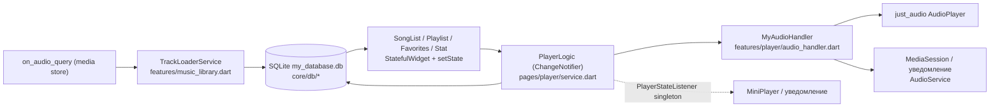

# Архитектура приложения Dot Music

> Описание по состоянию кода на коммите `173800a` ("small fixes"). В рабочем дереве есть одна незакоммиченная правка — `lib/core/db/db_helper.dart:69` (сортировка треков по `created_at DESC` вместо `title`); она сохранена и в этом документе учтена как текущее состояние.
>
> Связанный документ с проблемами и планом работ: [`TODO.md`](TODO.md).

---

## 1. Общая характеристика

Небольшое офлайн-приложение-музыкальный плеер на Flutter. Локальные аудиофайлы сканируются через `on_audio_query`, метаданные и пользовательские данные хранятся в SQLite (`sqflite`), воспроизведение идёт через `just_audio` + `audio_service` с уведомлением/медиа-сессией Android.

| Подсистема | Технология | Где используется |
|---|---|---|
| UI | Flutter Material 3, `setState` | `lib/features/pages/**` |
| Навигация | `go_router` 16.x | `lib/core/router.dart` |
| Локальная БД | `sqflite`, `path_provider` | `lib/core/db/**` |
| Сканирование медиатеки | `on_audio_query` | `lib/features/music_library.dart`, `lib/core/service.dart` |
| Звук / фон | `just_audio`, `audio_service`, `just_audio_background` (не используется в коде) | `lib/features/player/**` |
| Разрешения | `permission_handler` (через `on_audio_query.permissionsRequest()`) | `lib/features/music_library.dart` |
| Логирование | `logger` | `lib/core/config.dart` |
| DI / состояние | `provider` — только объявлен в `pubspec.yaml`, в коде не применяется | — |
| Хранение настроек | `shared_preferences` — объявлен, но не используется | — |

Официально описаны сборки Android/iOS (`README.md:24-28`); каталоги `linux/`, `macos/`, `windows/` присутствуют, но сценарии их работы в коде не предусмотрены (`UriType.EXTERNAL` в `on_audio_query` — Android-ориентированный путь).

---

## 2. Точка входа и инициализация

`lib/main.dart:9-18`:

1. `WidgetsFlutterBinding.ensureInitialized()`;
2. `await DatabaseHelper().db` — ленивое открытие/создание БД;
3. `await initAudioService()` — создание `MyAudioHandler` и запись его в глобальный `late MyAudioHandler audioHandler` (`lib/features/player/audio.dart:4-14`);
4. `runApp(const DotMusic())` — `MaterialApp.router(routerConfig: router)` с минимальной темой (`useMaterial3: true`, только `appBarTheme.iconTheme`);
5. `unawaited(initTracksInBackground())` — автосканирование библиотеки сразу после запуска UI (`lib/main.dart:17`).

Кнопка на главной (`lib/features/pages/home/home.dart:76-80`) остаётся как «пересканировать» и защищена флагом `TrackLoadingState.isLoading`. `initTracksInBackground()` сбрасывает старую ошибку/прогресс перед новым запуском (`load_tracks.dart:24-32`).

Перед `AudioService.init()` на Android запрашивается `POST_NOTIFICATIONS` (`lib/features/player/audio.dart:8-14`) — без этого ongoing-уведомление и foreground service не работают на Android 13/14+.

---

## 3. Структура проекта

```text
lib/
├── main.dart                     # точка входа, MaterialApp.router, тема
├── core/
│   ├── config.dart               # единственный logger
│   ├── router.dart               # глобальный GoRouter, все маршруты
│   ├── service.dart              # поиск метаданных трека через on_audio_query
│   └── db/
│       ├── db.dart               # DatabaseHelper + migrateDatabase (v1→v3)
│       ├── schema.dart           # DDL всех шести таблиц
│       ├── db_helper.dart        # DbHelper: запросы к tracks, плейлистам
│       ├── crud.dart             # PlaylistService, PlaylistView, SongService
│       ├── fav_service.dart      # избранное
│       ├── block_service.dart    # чёрный список
│       ├── stat_crud.dart        # StatRepository: счётчики прослушиваний
│       ├── stat_service.dart     # выборки статистики
│       └── db_test.dart          # пока пустой файл (0 байт)
├── design/
│   ├── colors.dart               # 6 констант Color (не подключены к ThemeData)
│   └── art.dart                  # генератор градиентной обложки в temp
├── features/
│   ├── music_library.dart        # TrackLoaderService: разрешения + querySongs + запись в БД
│   ├── player/
│   │   ├── audio.dart            # глобальный audioHandler, AudioService.init
│   │   ├── audio_handler.dart    # MyAudioHandler: одна подписка на durationStream
│   │   ├── player_control.dart   # неиспользуемые хелперы next/prev/random
│   │   ├── player_manager.dart   # пустой файл
│   │   └── play_music.dart       # неиспользуемый второй AudioPlayer
│   ├── queue/queue.dart          # QueueService: ротация/шафл/вставка
│   ├── track_service/
│   │   ├── load_tracks.dart      # TrackLoadingState + initTracksInBackground
│   │   ├── delete_service.dart   # обёртка над BlockService
│   │   └── edit_info.dart        # диалог переименования трека
│   └── pages/                    # экраны и их UI-виджеты
│       ├── home/                 # HomePage, анимированный заголовок, форма плейлиста
│       ├── song_list/            # список всех треков, меню, диалог плейлиста
│       ├── playlist/             # список плейлистов и треки плейлиста
│       ├── favorite_songs/       # избранное
│       ├── player/               # PlayerPage, MiniPlayer, UI, service.dart (465 строк)
│       └── stat/                 # top/month/year отчёты
android/                          # flavors dev/prod, MainActivity, AudioService в манифесте
ios/                              # Runner, Info.plist (UIBackgroundModes audio), Podfile
test/
├── queue_test.dart               # guards очереди, пустой/невалидный индекс
├── db_migration_test.dart        # миграции v1→v3 на in-memory БД (sqflite_common_ffi)
└── widget_test.dart              # минимальный smoke-тест
pubspec.yaml                      # Dart ^3.8.1, Flutter-зависимости + sqflite_common_ffi (dev)
analysis_options.yaml             # стандартный flutter_lints без ужесточений
```

---

## 4. Слои и потоки данных

У проекта нет строгого разделения на слои: есть «почти слой» данных, «почти сервисы» и экраны с локальным состоянием. Ключевые связи:



### Нарушения слоёв

- `lib/core/db/crud.dart:3` импортирует `lib/core/service.dart`, то есть слой БД зависит от platform/permission-слоя (`on_audio_query`, запрос разрешений).
- `lib/features/pages/player/service.dart:4,441-447` (UI-слой) напрямую работает с `sqflite.Database` и выполняет SQL через `StatRepository`.
- `lib/features/player/audio_handler.dart:5` (аудиослой) зависит от `PlayerStateListener`, определённого в `lib/features/pages/player/player_holder.dart` (UI-слой).
- Вместо DI — глобальные синглтоны: `DatabaseHelper._instance`/`_db` (`db.dart:13-19`), `audioHandler` (`audio.dart:4`), `PlayerStateListener` (`player_holder.dart:8-9`), `_trackLoader` + статический `TrackLoadingState` (`load_tracks.dart:5-13`), `OnAudioQuery` в двух местах, глобальный `router` (`router.dart:15`).

---

## 5. Модель данных

База — `my_database.db` в `getApplicationDocumentsDirectory()` (`lib/core/db/db.dart:27-43`). `onCreate` выполняет DDL из `Schema.createTables` (`lib/core/db/schema.dart:64-71`).

| Таблица | Поля | Связи / примечания |
|---|---|---|
| `tracks` | `id`, `title`, `artist`, `path`, `playback_count`, `created_at` | `playback_count` nullable, нет `UNIQUE(path)` |
| `playlists` | `id`, `name`, `created_at` | нет `UNIQUE(name)` |
| `playlist_tracks` | `playlist_id`, `track_id`, `added_at` | PK `(playlist_id, track_id)`, FK с `ON DELETE CASCADE` |
| `listening_stat` | `track_id`, `month`, `year`, `playback_count` | FK на `tracks`; нет `UNIQUE(track_id, month, year)` |
| `favorite_songs` | `track_id` | FK на `tracks`; нет `UNIQUE(track_id)` |
| `black_list` | `track_id`, `path` | FK на `tracks`; нет `UNIQUE(track_id)` |

`onOpen` включает `PRAGMA foreign_keys = ON` (`db.dart:38-40`).

Контракты выборок не унифицированы: `DbHelper.getAllTracks()` переименовывает `id → track_id` и исключает чёрный список (`db_helper.dart:62-84`), `PlaylistView.getSongsFromPlaylist()` возвращает `track_id` + `playlist_id` (`crud.dart:74-104`), `DbHelper.getTrackInfoById()` возвращает только три поля (`db_helper.dart:44-60`). В коде повсюду используются `Map<String, dynamic>` и sentinel-значения: `0` = все треки, `-1` = избранное, `>0` = id плейлиста (`pages/player/service.dart:408-438`).

Версия БД поднята до `3` (`db.dart:47`). Логика миграций вынесена в публичную функцию `migrateDatabase(db, oldVersion, newVersion)` (`db.dart:12-31`) и покрыта тестами на in-memory БД: v1→v3 создаёт недостающие таблицы и добавляет `year`, повторное применение не создаёт дубли колонки. `lib/core/db/db_test.dart` по-прежнему пустой — тесты лежат в `test/db_migration_test.dart`.

---

## 6. Управление состоянием

Фактически используется четыре независимых механизма:

1. **`setState`** в StatefulWidget-страницах — загрузка списков, forms, удаление, избранное (`home.dart`, `music_list_page.dart`, `playlist.dart`, `playlist_list.dart`, `favorite_songs_page.dart`, `play_track.dart`, `mini_player.dart`).
2. **`PlayerLogic extends ChangeNotifier`** (`pages/player/service.dart:17-104`) — центральное состояние плеера: songs, currentSongIndex, isPlaying, isFavorite, repeatMode, позиция/длительность, счётчик. Состоит из пяти «менеджеров» в том же файле: `PlayerState`, `PlayerAudioManager`, `PlayerQueueManager`, `PlayerFavoriteManager`, `PlayerTrackManager`.
3. **Колбэки `refreshUI` / `refreshBtn` / `onPlaybackCountLoaded`** (`service.dart:18-20`), которые передаются из `PlayerPage` и дублируют `notifyListeners()`.
4. **Синглтоны/статические шины**: `PlayerStateListener` (`player_holder.dart`) для мини-плеера и кнопок уведомления; `TrackLoadingState` (`load_tracks.dart`) для прогресса сканирования.

`provider` и `shared_preferences` объявлены в `pubspec.yaml:23,29`, но не используются: нет `ChangeNotifierProvider`, очередь и позиция не сохраняются между запусками.

### Жизненный цикл плеера

- `PlayerPage.initState()` создаёт `PlayerLogic` и вызывает `_logic.init()` без `await` (`play_track.dart:49-58`).
- `init()` (`service.dart:49-65`): загрузка списка по `playlist` → ротация очереди → инкремент счётчика → проверка избранного → подписки на потоки → `playFromFile()` → `refreshUI()` + `notifyListeners()`.
- Очередь — не список «следующих», а ротация: `[текущий, ...после, ...до]` (`queue/queue.dart:6-21`); `currentSongIndex` всегда `0`. Режимы повтора: `off → one → random → off` (`service.dart:324-353`); `random` на практике вызывает обычный следующий трек (`:284-286`).
- `MiniPlayer` встроен как `bottomNavigationBar` на основных экранах и подписан на `PlayerStateListener`; `PlayerLogic` и `PlayerStateListener` — два источника правды о текущем треке.

---

## 7. Навигация

Глобальный `GoRouter` (`lib/core/router.dart:15-77`):

| Маршрут | Экран | Аргументы (`state.extra`) |
|---|---|---|
| `/` | `HomePage` | — |
| `/list` | `SongListPage` | — |
| `/playlists` | `PlaylistPage` | `int` id плейлиста |
| `/listpl` | `PlaylistsListPage` | — |
| `/player` | `PlayerPage` | `Map`: index, playlist, path, fromMiniPlayer |
| `/statistic`, `/statistic/top`, `/statistic/month`, `/statistic/year` | экраны статистики | доп. значения для month/year |
| `/fav` | `FavoriteSongsPage` | — |

Аргументы передаются через `extra` с прямыми приведениями (`as int`, `as Map<String, dynamic>`, `as bool`) без проверки; `errorBuilder` отсутствует. Навигация смешанная: `context.push` для переходов вперёд, `context.go` для «назад», а в `playlist_list.dart:1,54` — прямой вызов глобального `router.go("/")` (циклический импорт с `core/router.dart`). Кнопка «назад» в плеере выбирает маршрут по `playlist` (`play_track.dart:113-120`), а не по фактическому предыдущему экрану.

---

## 8. Сканирование библиотеки и фоновая работа

1. `initTracksInBackground()` (`track_service/load_tracks.dart:22-61`) обновляет статический `TrackLoadingState`, вызывает `TrackLoaderService.initializePlugin()` (фактически — `Future.delayed(500ms)`), затем `loadSongs()`.
2. `TrackLoaderService.loadSongs()` (`music_library.dart:23-63`) проверяет/запрашивает разрешения, вызывает `querySongs(uriType: UriType.EXTERNAL)` и возвращает `List<SongModel>`.
3. `addMissingSongsToDbWithProgress()` (`:65-95`) для каждого файла делает `getSongByPath` → `addSongToDb`. Внутри `SongService.addSongToDb` (`crud.dart:142-151`) снова вызывается `getTrackInfoByPath()`, который **при каждом вызове** запрашивает разрешения и делает `querySongs()` (`core/service.dart:5-21`) — O(N) method-channel вызовов при сканировании.
4. Статус/ошибка сканирования живут в глобальных статических полях и не очищаются при повторном запуске.

### Аудиосервис

- `MyAudioHandler extends BaseAudioHandler` (`audio_handler.dart:8-25`) содержит собственный `AudioPlayer`, транслирует `playbackEventStream` в `playbackState`, обрабатывает `ProcessingState.completed` через `onTrackComplete`.
- `playFromFile()` (`:33-65`) кеширует градиентную обложку (`design/art.dart`), кладёт `MediaItem`, вызывает `setFilePath` + `play`.
- `skipToNext/Previous` (`:147-154`) делегируют в `PlayerStateListener` — то есть работают только когда экран плеера создал `PlayerLogic`; после смерти процесса очередь не восстанавливается.
- `onTaskRemoved()` (`:142-144`) останавливает воспроизведение несмотря на `androidNotificationOngoing: true`.
- Параметры `artworkPath`/`artworkUri`, `updateMetadata()` и `customAction()` не задействованы; `queueIndex` в `PlaybackState` жёстко равен `0`.

### Платформенные особенности

- **Android**: `MainActivity extends FlutterFragmentActivity` и подключает `AudioServicePlugin` (`android/app/src/main/kotlin/.../MainActivity.kt`); flavor'ы `dev`/`prod` в `android/app/build.gradle.kts:45-57`; манифест объявляет разрешения на storage/audio, `FOREGROUND_SERVICE`, `WAKE_LOCK`, сервис `AudioService` и `MediaButtonReceiver`.
- **iOS**: `AppDelegate.swift` — стандартный шаблон; в `Info.plist` добавлены `UIBackgroundModes = audio` и `NSAppleMusicUsageDescription`; `ios/Podfile` восстановлен из шаблона Flutter, так что `pod install` из `README.md:66-70` теперь выполним.
- **Десктоп**: каталоги есть, но поддержка не реализована.

---

## 9. Тесты и качество кода

- `flutter test --no-pub`: **9 тестов проходят** — `test/queue_test.dart` (границы очереди), `test/db_migration_test.dart` (v1→v3, идемпотентность) и smoke-тест в `test/widget_test.dart`. `lib/core/db/db_test.dart` остаётся пустым; тесты миграций живут в `test/`.
- `flutter analyze --no-pub`: **0 ошибок, 62 замечания** — в основном 28 предупреждений (14 вызовов × 2 правила: `invalid_use_of_visible_for_testing_member` / `invalid_use_of_protected_member`) в `pages/player/service.dart` (вызовы `notifyListeners()` вне сабкласса), 28 `withOpacity` deprecated, `use_build_context_synchronously` в `music_list_page.dart:140` и `edit_info.dart:62`, отсутствие `key` у публичных виджетов и т.д. Неиспользуемый импорт в `main.dart` убран.
- `dart format --output=none --set-exit-if-changed lib test`: **43 из 48 файлов** требуют форматирования.
- `analysis_options.yaml` содержит только стандартный `flutter_lints`; строгие правила (`unawaited_futures`, `discarded_futures`, `strict-casts`, `avoid_dynamic_calls`) не включены, поэтому многие асинхронные ошибки и unsafe cast статически не ловятся.

Подробный список дефектов, приоритеты и предложения по исправлению — в [`TODO.md`](TODO.md).

---

## 10. Как запускать и проверять

```bash
flutter pub get
flutter analyze --no-pub          # 0 ошибок; 28 предупреждений + info-замечания
flutter test --no-pub             # 9 тестов, зелёные
flutter run --flavor dev          # Android
dart format --output=none --set-exit-if-changed lib test
```

Android-релиз подписывается ключом из `android/key.properties` (файл в `.gitignore`); если файла нет, `buildTypes.release` fallback'ится на debug-подпись только для локальной сборки. Bundle id пока остаётся `com.example.dot_music*` — его смена требует решения по миграции данных существующих пользователей (см. `TODO.md`, P0-9).

В текущем окружении `flutter build apk --flavor dev` падает ещё до компиляции Dart из-за несовместимости Gradle/Java 27 (`jlink`), это не связано с кодом приложения. iOS-сборку здесь проверить нельзя (нет macOS/Xcode), но `ios/Podfile` и `Info.plist` приведены в рабочее состояние.
